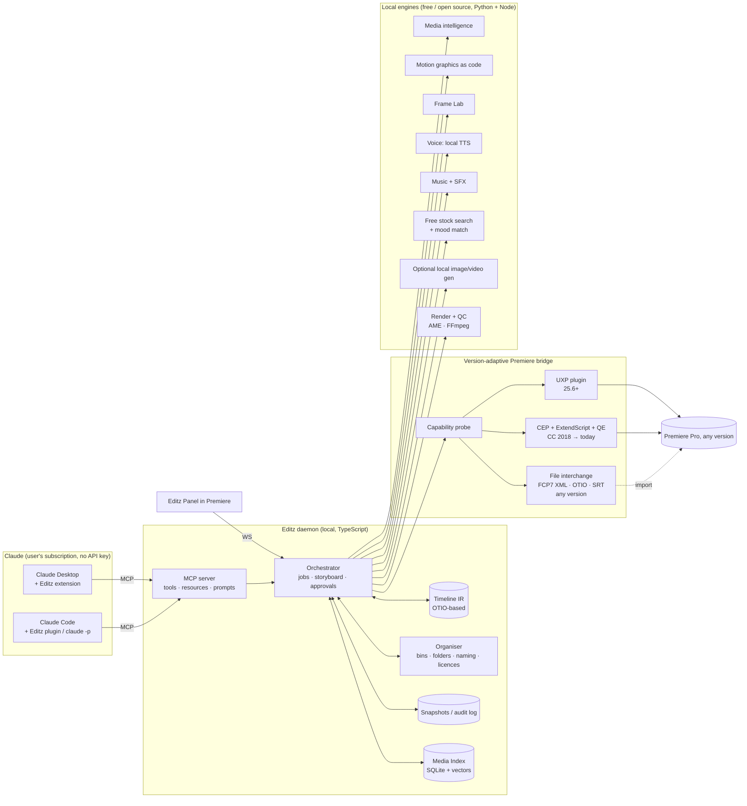

# Editz — Product Requirements Document

**One prompt, pro-grade video: Claude drives Adobe Premiere Pro, with no other paid dependencies**

| | |
|---|---|
| Status | Draft v0.3 |
| Date | 2026-11-24 |
| Platform | macOS (Apple Silicon) first. The architecture stays cross-platform so a Windows version is possible. |
| Premiere support | **Any version.** Each version gets a different level of automation (§10). |
| Paid dependencies | **Only two:** a Claude subscription (Pro or Max) and an Adobe Creative Cloud subscription. Everything else is free and open source, or a free account. |
| Research basis | Web and GitHub research done 2026-11-24. Items marked **[verify]** were not confirmed from a primary source. GitHub star counts were not audited. |

### What changed in v0.3
1. **Built-in local video generation** (§9.8). LTX-2.x and Wan 2.2 run on the Mac through MLX, using a "generate small, finish big" pipeline. 2.5D fallbacks work on every Mac.
2. **Local model catalogue and system budget** (§9.11). Models, sizes and speeds, plus a resource governor so Premiere stays smooth.
3. **Editz Link** (§9.12). A second Mac adds compute: as a job farm over Thunderbolt Bridge or Ethernet, or by splitting a model over Thunderbolt 5 RDMA (experimental).
4. **Zero-skill operation** (§5.5). One installer, auto hardware tuning, Doctor self-repair, and undo everything.

### What changed from v0.1
1. **Works with any Premiere version.** The bridge picks a backend for each version: UXP, CEP/ExtendScript, or plain file interchange (§10).
2. **No paid dependencies.** These are removed:
   - **Cloud APIs:** fal.ai, Runway, Veo, Kling, ElevenLabs, Topaz, Twelve Labs, Gemini, Deepgram.
   - **Paid stock and tools:** Storyblocks, Shutterstock, Getty, Remotion company licence, cloud GPUs.

   Their replacements:
   - Local, open-source models.
   - Free stock and audio sources.
   - Assets Claude generates itself (§9).
3. **Runs on the Claude subscription, not the Claude API.**
   - Claude Desktop or Claude Code is the brain.
   - Editz never calls the Claude API and needs no API key (§8).
4. **Free internet media with mood matching.**
   - Searches free sources: Pexels, Pixabay, Openverse, Wikimedia, NASA, Freesound, Free Music Archive and others.
   - Picks clips that match the video's mood, theme and style.
   - Records the licence of every asset.
5. **Autopilot for people who aren't editors.** Plain-language brief, then a storyboard to approve, then a finished video (§5).
6. **Project organisation.** Sorts clips into A-roll, B-roll, Music, VO, SFX, Graphics and more, in both Premiere bins and on disk (§11).
7. **Claude voice-over.** Claude writes the script and a free local TTS model speaks it. A "Voice" tool set covers this (§9.5).
8. **Full control with a safe escape hatch.** For anything without a dedicated tool, Claude writes and runs a script. A snapshot is taken first (§7).

---

## 1. Summary

Editz is a free, local app. One prompt to Claude can research, plan, organise, cut, animate, fix frames, voice, score, caption, grade, check and export a video. The result is a real, editable Premiere Pro project. Editz works with whatever Premiere version you have and costs nothing beyond your Claude and Adobe subscriptions.

Editz is made of eight parts:
1. **Editz MCP server.** Claude Desktop or Claude Code connects to it using your subscription.
2. **A version-adaptive Premiere bridge.** It uses UXP on new versions, CEP/ExtendScript on older ones, and XML/SRT file interchange on very old ones. It probes the running version and picks the best path.
3. **Timeline IR.** A canonical timeline model built on OpenTimelineIO. Claude edits the model; Editz compiles it into whatever the bridge can apply.
4. **Local engines.** All free and open source:
   - Media analysis.
   - Motion graphics as code.
   - Frame fixes.
   - Voice and music.
   - Free stock search.
   - Optional local image and video generation.
5. **Organiser.** Classifies media, builds the bin and folder structure, names and labels clips, and keeps the licence ledger.
6. **Autopilot and Pro modes.** Autopilot is for non-editors. Pro mode gives editors approval at each step and fine control.
7. **QC and review loop.** Measurable checks, plus Claude reviewing sampled frames against a craft checklist. It repeats until the cut passes.
8. **Craft Skills.** Claude Skills holding professional editing knowledge, so a non-editor still gets a pro result.

---

## 2. Problem

| Who | Pain today |
|---|---|
| Non-editors (founders, teachers, marketers, small businesses) | Have footage and an idea but no editing skill. AI editors output flat renders, lock content into their own apps, or charge per month and per credit. |
| Solo creators | Spend hours on silence cuts, b-roll hunting, captions, music and loudness. Paying for stock, voice and AI tools adds up. |
| Editors on older Premiere versions | Every new automation tool needs the latest Premiere. |
| Pro editors | Want an assistant that does assembly, logging, organising, captions and QC, while they keep creative control. |

Community Premiere MCP servers prove Claude can drive Premiere. But they:
- Need specific versions.
- Expose raw operations without editing judgement.
- Rarely confirm that an operation worked.
- Have no media understanding, asset sourcing, voice, music or QC.

---

## 3. Goals, constraints and non-goals

### Goals
- **G1. One-prompt production.** A plain request produces an editable Premiere project plus exports.
- **G2. Professional quality for anyone.** Every output meets measurable delivery specs and a craft checklist (§13), whatever the user's skill.
- **G3. Native, editable output.** Results land as real Premiere objects: bins, clips, tracks, markers, captions, effects and templates. Generated assets are kept as source files so they can be re-rendered.
- **G4. Reliability.** Every change is transactional where the backend allows, read back and confirmed, and undoable. A snapshot is taken before anything destructive.
- **G5. Full control.** Anything Premiere can do through any of its scripting APIs, Editz can do.

### Hard constraints
- **C1. Any Premiere version.** No version is refused. If live automation isn't possible, Editz falls back to file interchange plus guided steps (§10).
- **C2. Zero paid dependencies.** The only costs are the Claude subscription and the Adobe CC subscription.
  - **Allowed:** free open-source software with permissive or copyleft licences (copyleft runs as a separate process); free asset sources; free accounts with free API keys (Pexels, Pixabay, Freesound, Unsplash, Hugging Face).
  - **Not allowed:** pay-per-use APIs, trials, or credit systems.
- **C3. No Claude API key.** All reasoning goes through the user's signed-in Claude Desktop or Claude Code.
- **C4. Local-first.** Media never leaves the machine, except search queries sent to free stock APIs and downloads from them.
- **C5. Every asset is licence-safe.** Each external or generated asset carries a licence record. A **Usage Mode** controls which licences are allowed:
  - **Commercial** (default): only licences that allow commercial use.
  - **Personal / non-commercial:** also allows non-commercial (NC) assets and model weights.

### Non-goals (v1)
- Building our own NLE.
- Downloading copyrighted videos from YouTube, social platforms or other non-free sources.
- Auto-publishing to social platforms. v1 exports only.
- Cloud rendering or cloud GPUs.
- Cloning someone's voice without their consent.

---

## 4. Personas

| Persona | Typical request |
|---|---|
| **Non-editor Nina** (founder) | "Here are my phone clips. Make a 45-second launch video for Instagram, upbeat, with music and captions." |
| **Creator Casey** | "Cut this 40-min podcast into a 12-min YouTube episode and 5 shorts." |
| **Teacher Tom** | "Make a 3-minute explainer on photosynthesis with diagrams, a voice-over and free footage." |
| **Editor Eli** (on Premiere 2022) | "Organise everything into bins, sync multicam, log the takes, build a selects sequence." |
| **Motion Mia** | "Animated lower-thirds for all 6 speakers in our brand style." |

---

## 5. User experience

### 5.1 Surfaces
1. **Claude Desktop + Editz extension.** One-click install as a Desktop Extension (`.mcpb`) [verify current format name]. Chat in Claude and Editz does the work.
2. **Claude Code + Editz plugin.** Bundles the MCP server, Craft Skills, subagents (logger, researcher, motion designer, QC reviewer) and hooks. Also used for headless runs: `editz run brief.yaml` calls `claude -p` under the user's own login.
3. **Editz Panel inside Premiere.**
   - **Older versions:** a CEP panel.
   - **25.6 and later:** a UXP panel.
   - **What it shows:** status, the plan or storyboard with Approve buttons, progress, snapshots, the licence and credits list, and a chat box.
   - **How chat works:** the daemon runs a local Claude Code session under the user's subscription. There is no API key.
4. **Review page (local web page).** Storyboard, preview render, QC report, before/after comparison, and per-shot comments that go back to Claude.

### 5.2 Two modes

| | **Autopilot** (non-editors, default for new users) | **Pro** (editors) |
|---|---|---|
| Input | Plain-language goal. Editz asks up to 5 short questions: platform, length, audience, tone, must-haves. | Prompt, brief file or direct tool calls. |
| Checkpoints | 2: **storyboard** (script, shot stills, music mood, VO voice) and **final preview**. | Approve each plan step, or none. Configurable. |
| Decisions | Editz picks from Craft Skills and genre recipes. | User overrides anything. |
| Feedback | Plain language: "intro is slow", "music too loud", "use more city shots". Editz turns it into timeline changes. | Timecode-level instructions, or editing in Premiere directly. |
| Safety | Originals never touched. A snapshot before every change. "Undo last change" in plain words. | Same, plus raw script access. |

### 5.3 Core loop
```
Brief ──► Understand ──► Research ──► Organise & Analyse ──► Storyboard / Plan
                                                                  │  ◄── approval (Autopilot: storyboard)
                                                                  ▼
Deliver ◄── QC + Claude review ◄── Enhance (motion, VO, music, SFX, colour, captions) ◄── Build timeline
   ▲                 │
   └──── fix list ◄──┘   (loops until QC passes and the rubric average is ≥ 4, up to N rounds)
```

### 5.4 Acceptance scenarios
1. Non-editor: "Here are 30 phone clips from our café. Make a 30-second Reel that feels warm and cosy, with music and captions."
2. "Cut this 40-min podcast into a 12-min YouTube edit and 5 shorts. Remove dead air and keep the best stories."
3. "Make a 2-minute explainer on our Q3 numbers with animated charts, a voice-over in a calm female voice, and free b-roll."
4. "Organise this messy folder of 400 files into a proper project."
5. "Remove the boom mic in shot 14, stabilise shots 3–7, slow-mo the jump, upscale the drone clip."
6. "Make Spanish and Hindi versions with translated captions and dubbed VO."
7. Same as scenario 2, but on **Premiere Pro 2020** with no UXP.
8. "Find free footage of rainy Tokyo streets that matches the moody blue look of my A-roll."
9. Non-editor on a 16 GB MacBook Air with a Mac mini linked by cable: "Make a 45-second product teaser. No footage, just this logo and a description." Editz uses AI-generated shots, motion graphics, VO and music, and runs the heavy jobs on the Mac mini.

### 5.5 Zero-skill operation (user skill level 0)
The user never needs Terminal, a settings screen or editing vocabulary. Editz handles each part as follows:

| Area | What Editz does on its own |
|---|---|
| **Install** | One signed `.dmg` installs everything: the daemon, the Premiere plugin for **every** installed Premiere version, the Claude Desktop extension and the Claude Code plugin, plus bundled Python, Node and FFmpeg. No Terminal and no admin prompts beyond the macOS standard. |
| **Setup** | Detects hardware (§9.10), runs a 60 s benchmark and picks the profile and model sizes. Core models download in the background with resume and checksums. Packs download the first time a feature needs them. |
| **Accounts** | Works keyless out of the box (Openverse, Wikimedia, NASA, Internet Archive). For Pexels, Pixabay, Unsplash and Freesound, it opens the free sign-up page and the user pastes the key into one box. Editz cannot create accounts for the user. |
| **First run** | Makes a 10-second sample video from bundled clips to prove the whole chain works. Then Claude asks at most 5 plain questions about the video (audience, length, vibe), never technical ones. |
| **Doctor** | Self-test on every start: Premiere link, plugin, models, disk, permissions, helper Macs. Auto-repair covers reinstalling the plugin, re-downloading a corrupt model, restarting a worker and reconnecting Premiere. Errors are shown in plain English with one "Fix it" button, never a stack trace. |
| **Safety** | Snapshot before every change. A big **"Undo everything Editz did"** button. Every job is resumable after a crash, quit or sleep. |
| **Guided steps** | Used only where Adobe blocks automation: an arrow on screen plus a one-click "Done". |
| **Updates** | The app, plugins, helpers and models auto-update with signed packages, and each update can be rolled back. |
| **Hardware use** | The resource governor (§9.11) and Editz Link (§9.12) are fully automatic. |

---

## 6. System architecture



### 6.1 Components

| # | Component | Responsibility | Tech (all free) |
|---|---|---|---|
| 1 | **MCP server** | One server for Claude. Tools, resources (`editz://...`) and prompts. About 25 tools are advertised by default; the rest are found through `search_tools`. | TypeScript, MCP TS SDK, stdio + Streamable HTTP |
| 2 | **Orchestrator** | Job queue, storyboard and plan state, approvals, retries, progress, cancellation, compute budget. | TypeScript, SQLite |
| 3 | **Timeline IR** | Version-independent timeline model. Every backend compiles from it. | OpenTimelineIO + Editz metadata |
| 4 | **Capability probe** | Detects Premiere version, OS, UXP, CEP, ExtendScript/QE, AME, After Effects, Photoshop and Audition. Builds the tool → backend routing table. | Runs on connect |
| 5 | **UXP bridge** | Primary path on 25.6+: `lockedAccess` + `executeTransaction`, labelled undo, readback. | UXP manifest v5, `.ccx` |
| 6 | **CEP/ExtendScript bridge** | Primary path on CC 2018 through 25.5. On 25.6+ it fills UXP gaps (razor, speed, captions, MOGRT reads, Auto Reframe, scene detection). | CEP panel with Node enabled, ExtendScript, QE DOM; self-signed ZXP |
| 7 | **File-interchange path** | For any version, including CS6 and CC 2014–2017, or when live control fails. Writes FCP7 XML (or OTIO where supported) plus SRT plus organised media. Imports through ExtendScript if available, otherwise one guided File → Import step. | Python `opentimelineio` + FCP7 XML adapter |
| 8 | **Organiser** | Classifies media, creates bins and folders, names and labels clips, writes metadata, keeps the licence ledger and credits (§11). | TS + Python classifiers |
| 9 | **Media intelligence** | Transcripts, speakers, shots, tags, faces, OCR, beats, audio type, mood and colour profiles, embeddings. | Local models (§9.1) |
| 10 | **Motion engine** | Titles, lower thirds, kinetic captions, charts, maps, explainers, transitions, as code rendered to ProRes 4444 with alpha. | HyperFrames, Motion Canvas, Manim, Lottie |
| 11 | **Frame Lab** | Masks, cut-outs, object removal, upscaling, slow-motion, stabilising, depth, face restore. | Local models (§9.3) |
| 12 | **Voice** | Claude writes the script. Local TTS speaks it. Timing aligned to the script. Optional consented voice clone. | Kokoro, Chatterbox (§9.5) |
| 13 | **Music + SFX** | Free library search, local music generation, MIDI that Claude composes, procedural SFX, beat sync, ducking. | §9.6 |
| 14 | **Free stock + mood match** | Searches free sources, ranks results by fit to the brief, mood and colour, downloads, records the licence. | §9.7 |
| 15 | **Local generation (built in)** | Keyframes, thumbnails, backgrounds and AI video shots, sized to the hardware, with 2.5D fallback. | FLUX.1 schnell, LTX-2.x, Wan 2.2 via MLX (§9.8) |
| 15b | **Resource governor + Editz Link** | Keeps Premiere smooth, and spreads jobs across helper Macs. | §9.11, §9.12 |
| 16 | **Render + QC** | AME export (scripted on every version that has AME), FFmpeg drafts, QC checks, contact sheets for Claude. | AME (in CC sub), FFmpeg |
| 17 | **Craft Skills** | Editing knowledge, genre recipes, platform specs, brand kits, QC checklist. | Claude Skills (markdown) |

### 6.2 Key design decisions
1. **IR-first and backend-agnostic.**
   - Claude edits one timeline model.
   - The compiler emits the cheapest valid form for the detected backend: UXP operations, ExtendScript operations, or an XML/OTIO file.
   - This is what makes "any version" possible.
2. **Confirm everything.**
   - Every change returns `{status, readback, diff, undo_label, warnings, backend}`.
   - If the readback doesn't match: retry, then try the next backend, then restore the snapshot.
3. **Bulk builds use import, small edits use live operations.**
   - Initial assembly is one XML/OTIO import. This works on every version and avoids freezing Premiere.
   - Fine changes use live operations in chunks of 25 or fewer.
4. **Local does the looking, Claude does the thinking.**
   - Local models do heavy perception: tagging thousands of frames, transcripts, embeddings.
   - Claude gets compact summaries and small contact sheets.
   - This keeps the user within their subscription limits.
5. **Claude makes what it can as code.**
   - Titles, graphics, charts, maps, LUTs, captions, scripts, MIDI and SFX recipes are generated as editable source, then rendered locally.
   - No paid generative service is needed.
6. **Snapshots before anything destructive.**
   - Duplicate the sequence, save an IR snapshot, and save the project as a checkpoint copy.
   - Original media is never modified or deleted.
7. **Adobe's own MCP is a future backend.** It enters private beta early 2027. When it's available, add it behind the same IR.

### 6.3 Timeline IR (abridged)
```jsonc
{
  "project": {"id": "prj_…", "fps": "30000/1001", "resolution": [1080, 1920],
              "usage_mode": "commercial", "brand_kit": "kits/cafe.json"},
  "sequences": [{
    "id": "seq_reel_v2",
    "tracks": {
      "video": [{"id": "V1", "role": "a_roll"}, {"id": "V2", "role": "b_roll"}, {"id": "V3", "role": "graphics"}],
      "audio": [{"id": "A1", "role": "dialogue"}, {"id": "A2", "role": "voiceover"},
                {"id": "A3", "role": "music"}, {"id": "A4", "role": "sfx"}],
      "captions": [{"id": "C1", "lang": "en", "style": "bold_pop"}]
    },
    "items": [{
      "id": "clp_0007", "track": "V2", "media": "med_pexels_123456",
      "src_in": 2.0, "src_out": 4.5, "rec_in": 6.0,
      "reason": "B-roll for 'fresh coffee every morning'; warm palette matches A-roll (ΔE 6)",
      "license": {"source": "pexels", "terms": "Pexels License", "commercial": true, "attribution": "optional"}
    }]
  }]
}
```

---

## 7. MCP tool surface

Tools advertised by default are in **bold**. All tools that change something return the confirmation envelope. Each tool declares the backends it supports, and the router picks one for the detected Premiere version.

| Tool set | Tools |
|---|---|
| Session | **`editz_status`**, **`connect_premiere`**, `get_capabilities`, `set_mode` (autopilot / pro), `set_usage_mode` (commercial / personal), `search_tools`, `describe_tool`, `invoke_tool` |
| Brief & story | **`start_brief`** (asks the Autopilot questions), **`make_storyboard`**, `write_script`, `story_outline`, `paper_edit`, `approve` |
| Organise | **`organize_project`** (classify, then bins, folders, names, labels), `create_bin`, `move_items`, `rename_items`, `set_label`, `set_metadata`, `find_duplicates`, `consolidate_media`, `project_report` |
| Media & analysis | **`ingest_media`**, **`analyze_media`**, **`search_media`** (by text, visuals or mood), `get_transcript`, `contact_sheet`, `make_proxies`, `relink` |
| Research & stock | **`research_web`** (uses Claude's own web search and fetch), **`find_free_media`** (video, photo, music, SFX, with mood matching), `download_asset`, `license_report`, `make_credits` |
| Timeline | **`get_timeline`**, **`apply_timeline_diff`**, `create_sequence`, `insert`, `overwrite`, `ripple_delete`, `trim`, `slip`, `slide`, `razor`, `set_speed`, `add_transition`, `sync_multicam`, `snapshot`, `restore_snapshot`, `undo_last` |
| Look | **`apply_effect`**, `set_param`, `keyframe`, `apply_lut`, `make_lut` (Claude writes a `.cube` file), `color_match`, `auto_reframe` |
| Motion | **`create_motion_graphic`**, `lower_thirds`, `kinetic_captions`, `animated_chart`, `animated_map`, `title_card`, `end_card`, `apply_mogrt`, `set_mogrt_params`, `ae_comp` (if After Effects is installed) |
| Voice | **`generate_voiceover`** (script → local TTS → timed clip on the VO track), `list_voices`, `clone_my_voice` (consent required), `dub` |
| Music & SFX | **`add_music`** (free library or local generation, matched to mood and beat), `compose_music` (Claude writes MIDI, rendered locally), `make_sfx`, `beat_sync`, `separate_stems` |
| Frame Lab | **`frame_fix`** (remove object, stabilise, upscale, slow-mo, denoise, cut-out, face restore), `segment_track`, `depth_map` |
| Generate (optional) | `generate_image`, `generate_thumbnail`, `generate_clip` (only if hardware allows) |
| Audio | **`audio_mix`** (ducking, loudness, EQ presets), `enhance_speech`, `remove_silence`, `remove_filler` |
| Captions | **`create_captions`**, `translate_captions`, `style_captions`, `export_sidecar` |
| QC & review | **`run_qc`**, **`review_cut`**, `compare_versions` |
| Export | **`export`** (presets: YouTube, Reels/TikTok/Shorts, master, podcast audio), `export_variants`, `export_xml`, `export_otio`, `export_thumbnail`, `export_metadata` (title, description, chapters, tags, credits) |
| Escape hatch | `run_script` (ExtendScript or UXP JS that Claude writes for anything not covered). How it runs: snapshot first; static checks; read-only scripts run freely; changing scripts need approval in Pro mode and run with a snapshot in Autopilot. Each successful script is saved to a local recipe library so it can be reused. |

**Resources:** `editz://project`, `editz://bins`, `editz://timeline/{seq}`, `editz://media/{id}/transcript`, `editz://licenses`, `editz://qc/{seq}`, `editz://brand/{kit}`, `editz://capabilities`.
**Prompts (recipes):** `make_reel`, `podcast_to_youtube`, `long_to_shorts`, `explainer`, `product_promo`, `event_recap`, `tutorial_screen_recording`, `organize_my_project`, `localize`.

---

## 8. Claude layer (subscription only)

| Element | Spec |
|---|---|
| Clients | **Claude Desktop** (Desktop Extension) and **Claude Code** (plugin). Both use the user's Pro or Max login. Editz never holds an API key. |
| Models | Whatever the user's plan includes. In Claude Code, subagents use smaller models (for example Haiku for logging, Sonnet for selects) to save usage. The main session plans and reviews. |
| Web research | Claude's built-in web search and fetch. Editz adds the free stock-API tools. |
| Vision | Claude reviews still images, not raw video. Editz returns small contact sheets, frame pairs around cuts, caption-safe overlays and loudness graphs as MCP image results. |
| Headless runs | `editz run` and the Premiere panel's chat start `claude -p --output-format stream-json` with the Editz MCP config, under the user's login [verify current flags]. |
| Usage budget | Subscription limits apply (rolling and weekly windows). To stay within them, Editz: does perception locally; sends summaries and searches instead of full transcripts; caps contact sheets (≤ 24 frames per review round by default); keeps stable context in Skills; shows "usage-light" and "thorough" options. |
| What Claude creates directly | Scripts, VO text, storyboards, shot lists, titles, motion-graphics code, SVG illustrations and icons, chart and map specs, LUTs (`.cube`), caption files and translations, MIDI music, SFX synthesis recipes, YouTube titles, descriptions and chapters, thumbnail layouts, and ExtendScript or UXP scripts. |
| What Claude can't do itself | Produce audio or video pixels. Local engines render Claude's output. |
| Craft Skills | `editz-cut-grammar`, `editz-pacing-by-genre`, `editz-storyboard`, `editz-captions`, `editz-typography-motion`, `editz-color`, `editz-audio-mix`, `editz-voiceover-writing`, `editz-music-mood`, `editz-platform-specs`, `editz-brand-kit`, `editz-organize`, `editz-licensing`, `editz-qc-rubric`, `editz-premiere-scripting` (ExtendScript and UXP reference, per version). |
| Memory | A per-project file of decisions and the user's taste ("no whooshes", "prefers warm grade"), carried into future plans. |

---

## 9. Engine stack (free only)

**Licence column:**
- **C** = safe for commercial use (default).
- **P** = only enabled in Personal mode, because the licence is non-commercial.
- ⚠ = check before shipping.

### 9.1 Media intelligence
| Capability | Default (licence) | Alternatives |
|---|---|---|
| Speech to text, word timings | Whisper large-v3-turbo via mlx-whisper / whisper.cpp (MIT, C) | Parakeet TDT v3 via FluidAudio (CC-BY-4.0 / Apache, C); Premiere Speech to Text (26.5+ UXP transcript API) |
| Speaker detection | pyannote Community-1 (CC-BY-4.0, free Hugging Face token, C) | — |
| Shot boundaries | PySceneDetect (BSD-3, C) | Premiere Scene Edit Detection through ExtendScript `performSceneEditDetectionOnSelection` [verify per version] |
| Audio type (speech, music, noise, silence) | inaSpeechSegmenter (MIT) + PANNs (MIT) (C) | YAMNet (Apache) |
| Visual tags and descriptions | SigLIP 2 zero-shot tags (Apache, C) + Florence-2 captions (MIT, C) | Moondream 2 (Apache), Qwen-VL small models (check each size's licence ⚠). Claude reviews contact sheets only for key decisions. |
| Mood and colour profile | Colour palette, brightness, contrast, motion energy, pace; SigLIP "mood" prompts (warm, moody, energetic, calm…) | — |
| Faces, OCR | Apple Vision framework (free, built into macOS) | OpenCV YuNet, PaddleOCR (Apache) on Windows |
| Beats | beat_this (MIT, C) | librosa (ISC) |
| Search | SigLIP 2 embeddings + sqlite-vec (MIT/Apache) | LanceDB (Apache) |

### 9.2 Motion graphics (all made by Claude as code)
| Need | Default | Alternatives |
|---|---|---|
| Titles, lower thirds, kinetic type, end cards, explainers | **HyperFrames** (Apache-2.0): HTML/CSS/JS → frame-accurate render | Motion Canvas / Revideo (MIT) |
| Animation inside comps | CSS / Web Animations, anime.js (MIT) | GSAP is free since 2025, but its licence bars use in tools that compete with Webflow ⚠. Avoid by default. |
| Charts and data viz | D3 (ISC) or Vega-Lite (BSD) inside HyperFrames | Manim (MIT) for math and science |
| Maps | Natural Earth data (public domain) + D3-geo | OpenStreetMap (ODbL; attribution auto-added) |
| 3D | three.js / react-three-fiber (MIT) in HyperFrames; Blender (GPL, free) via blender-mcp (MIT) | — |
| Icons, illustrations | Claude-written SVG; Lucide / Tabler / Iconify sets (MIT/ISC) | unDraw (free licence ⚠) |
| Lottie | lottie-web (MIT); LottieFiles free animations (Lottie Simple License ⚠) | — |
| Native Premiere graphics | Fill in MOGRT templates (brand kit → text and colour params); Essential Graphics | After Effects comps, if the user has the All Apps plan |
| Fonts | Google Fonts (OFL) and Adobe Fonts (included in CC) | — |
| Remotion | **Excluded.** Needs a paid company licence above 3 employees. | — |
| Output | ProRes 4444 with alpha on V3+, with the source comp saved for re-render | — |

### 9.3 Frame Lab
| Op | Default (licence) | Notes |
|---|---|---|
| Segment and track | SAM 2.1 (Apache, C) | SAM 3 has a custom licence ⚠ |
| Cut-out / background removal | BiRefNet (MIT, C) | RobustVideoMatting (GPL, runs as a separate process, C) |
| Object removal | LaMa per frame + temporal smoothing (Apache, C) | ProPainter (P). DiffuEraser / MiniMax-Remover [verify licence]. |
| Upscale | Real-ESRGAN ncnn (BSD-3, C) | — |
| Slow-mo / frame interpolation | RIFE (MIT, C) | Premiere Optical Flow (built in) |
| Stabilise | Premiere Warp Stabilizer (in CC sub, applied as an effect) | FFmpeg vid.stab (GPL, free) |
| Depth / fake depth of field / parallax | Depth Anything V2 Small (Apache, C) | Larger sizes are non-commercial (P) |
| Face restore | GFPGAN (Apache, C) | CodeFormer (P) |
| Relight | IC-Light [verify licence] | — |
| Auto reframe | Premiere Auto Reframe through ExtendScript `autoReframeSequence` [verify per version] | Face/saliency tracking → keyframed Motion (local) |

### 9.4 Built-in Adobe features (already paid for in the CC subscription)
| Feature | How Editz uses it |
|---|---|
| Lumetri, Warp Stabilizer, Optical Flow, Morph Cut, Essential Sound, Essential Graphics | Applied and set through the bridge |
| Speech to Text, Auto Reframe, Scene Edit Detection | Scripted where the version allows [verify]. Otherwise the local equivalent. |
| Enhance Speech, Generative Extend (uses Firefly credits) | Not scriptable [verify]. Editz adds a **guided step** marker ("click here, then press Continue"). A local alternative is used if the user prefers. |
| Adobe Media Encoder | All exports, on every version that has AME scripting |
| Adobe Fonts | Used in titles and brand kits |
| After Effects / Photoshop / Audition | Used only if the user's plan includes them (All Apps). Never required. |
| Firefly (web and app, generative credits) | Optional guided step for users who want Firefly images or video. Never required. |

### 9.5 Voice-over (Claude writes, local TTS speaks)
| Need | Default (licence) | Notes |
|---|---|---|
| Natural VO, many voices | **Kokoro-82M** (Apache-2.0, C) | Fast on CPU and Apple Silicon. Several languages and voices. |
| Expressive VO, emotion control, own-voice cloning | **Chatterbox** (MIT, C) | Built-in watermark. Cloning only with recorded consent from the voice owner. |
| Dialogue / two-voice | Dia (Apache-2.0, C) [verify] | — |
| Higher-quality models with non-commercial weights | F5-TTS, XTTS-v2 (P) | Personal mode only |
| Pipeline | Claude writes the VO script tuned for timing (words per second by voice), marks emphasis and pauses, and runs TTS per paragraph. Editz then aligns the result with Whisper, places it on A2, ducks music, adds room tone and normalises. | Retakes via `generate_voiceover(take=2, direction="warmer, slower")` |
| Dubbing | Claude translates, TTS speaks per line, timing is fitted to the original segments, original dialogue is ducked or removed with stems. Lip-sync is optional (LatentSync / MuseTalk [verify licence], GPU-heavy). | — |

### 9.6 Music and SFX
| Need | Default (licence) | Notes |
|---|---|---|
| Free music library | Free Music Archive and ccMixter (CC; NC tracks only in Personal mode); Incompetech (CC-BY, attribution auto-added); Pixabay Music [verify API access]; Openverse audio | Mood, BPM, length and key matching |
| Local music generation | ACE-Step (Apache-2.0, C) [verify version] | Stable Audio Open (Stability community licence ⚠); MusicGen (P) |
| Claude-composed music | Claude writes MIDI (chords, melody, drums for a mood and length, hitting edit points), rendered with FluidSynth (LGPL) + GeneralUser GS / FluidR3 SoundFonts (permissive) | Exact cue timing with no licence risk; simpler sound |
| SFX library | Freesound API (free key; CC0/CC-BY; CC-BY-NC only in P) | BBC Sound Effects (P, RemArc licence) |
| Procedural SFX | Claude-designed whooshes, risers, hits, clicks, pops, transitions, synthesised in Python (numpy/scipy) | Free, unlimited, no licence |
| Stems | Demucs (MIT) / audio-separator with BS-RoFormer weights [verify weight licences] | — |
| Mix | Ducking rules (music −12 to −18 dB under speech), loudness `loudnorm` two-pass, true peak −1 dBTP | — |

### 9.7 Free stock media and mood matching
| Type | Sources (free, licence recorded per asset) |
|---|---|
| Video | Pexels API (free key), Pixabay API (free key), Wikimedia Commons, Internet Archive / Prelinger (public domain and CC), NASA Image & Video Library (public domain; logos restricted), Coverr / Mixkit (free licences; Mixkit has no API, so guided download) |
| Photos | Pexels, Pixabay, Unsplash API (free; must follow its download-tracking and attribution rules), Openverse, Wikimedia, Library of Congress, NASA |
| Music / SFX | §9.6 |
| Graphics / fonts | Google Fonts, Adobe Fonts, Iconify, Lucide, Tabler, Natural Earth |
| Excluded | YouTube, TikTok and Instagram downloads; anything without a clear licence; paid stock |

**Mood matching (how "fits the vibe" is computed):**
1. Claude turns the brief and each script beat into a **shot request**: subject, action, setting, mood words, colour temperature, pace, orientation, minimum resolution and duration.
2. Editz queries all enabled sources in parallel and pulls previews.
3. Local scoring: **0.45** semantic fit (SigLIP text↔frame) + **0.20** mood fit (SigLIP mood prompts) + **0.15** colour fit (palette distance to the A-roll or brand grade) + **0.10** motion/pace fit + **0.10** technical fit (resolution, fps, orientation, length). Duplicates and watermarks are filtered out.
4. Claude sees the top 6 as one contact sheet, picks the best and gives a reason.
5. Editz downloads the full file, grades it towards the project look (LUT or colour match), and records source, URL, author, licence, attribution text and date in the **licence ledger**.
6. Credits are auto-generated for the description or end card when required.

### 9.8 Local video and image generation (built in, free)

Editz generates video clips on the user's own Mac, with no credits or cloud. It does this when free stock scores below the mood-match threshold (§9.7) or when the user asks, for example "a slow drone shot over a neon city at dusk".

**Engines** (speeds are single-user reports, not controlled benchmarks; Editz measures each machine on first run):

| Model | Licence | Strength | Memory on a Mac | Reported speed |
|---|---|---|---|---|
| **LTX-2.x distilled** (LTX-2.3 / 2.5) via MLX ports: `mlx-video` (MIT) or `ltx-2-mlx` | LTX-2 Community Licence: **free, including commercial use, for organisations under $10M annual revenue** (all affiliates counted together). Above that, a paid licence is needed. Marked **C<10M** ⚠ | Fastest open model on a Mac. Generates synced audio. Text, image or audio → video. Multi-shot in 2.5 | int4 runs on 16 GB with low-RAM streaming. 32 GB+ recommended (int8). Full bf16 needs 96 GB+ | M4 Max: 704×480, 97 frames (4 s), 8 steps ≈ **2 min 17 s**. M3 Max 64 GB: 5 s at 768×512 ≈ 5–8 min. 10 s at 1024×576 ≈ 19–24 min |
| **Wan 2.2 TI2V-5B** via `mlx-video`, with Wan2.2-Lightning 4-step LoRA [verify LoRA licence] | Apache-2.0 (**C**, no revenue cap) | Default when the user is above $10M or chooses "strict free". Good motion | 8-bit, 32 GB+ recommended | 64 GB: 720p, 41 frames, 20 steps ≈ 15 min. With the 4-step LoRA, about 3–5 min (estimate, to be measured) |
| **Wan 2.2 14B** (I2V / T2V) | Apache-2.0 (**C**) | Best open quality | 64 GB+, or split across two Macs (§9.12) | Overnight queue or cluster only |
| Images: **FLUX.1 [schnell]** via mflux | Apache-2.0 (**C**) | Keyframes, backgrounds, thumbnails | 4-bit, about 8–12 GB | About 15–60 s per image |
| Image editing: Qwen-Image-Edit [verify Mac support] | Apache-2.0 (**C**) | Change a keyframe before animating it | 32 GB+ | Slow |
| Excluded by default | HunyuanVideo (territory limits ⚠), FLUX Kontext dev and other non-commercial weights (**P** only) | — | — | — |

At first run, Editz asks one plain question: "Is your organisation's yearly revenue above $10 million?" That answer picks between LTX and Wan. The answer is stored in the licence ledger.

**"Generate small, finish big" pipeline.** This is what makes generation practical on a laptop:
1. **Prompt.** Claude writes the shot prompt from the storyboard: subject, action, camera move, lens, light, mood, and a palette matched to the A-roll. It also writes a negative prompt.
2. **Keyframe first.** A FLUX still (or the best stock photo, or a frame from the user's footage) fixes the look in seconds. Claude approves it from a contact sheet. In Pro mode, the user approves it.
3. **Draft.** Image-to-video at 384p with few steps (about 30–60 s). Claude checks the motion on a frame strip.
4. **Final.** 480–576p, 2–5 s per shot. Pro edits rarely hold a b-roll shot longer than 4 s. Longer shots are chained: the last frame of one shot becomes the image for the next. LTX-2.5 can also do multi-shot.
5. **Finish.** Real-ESRGAN ×2–×4 upscale, RIFE to 24/30/60 fps, project LUT grade, and light film grain so the shot blends with real footage.
6. **QC.** Claude reviews the frame strip for artefacts: hands, garbled text, morphing, flicker. It retries with a new seed up to 3 times, then falls back (below).
7. **Ledger.** Records model, licence, prompt and seed, and labels the shot "AI-generated". Adds C2PA content credentials where the Premiere version supports it (26.5+ `C2PAService`).
8. **Consistency.** A reference image per character or product, plus a fixed seed and style keyframe, keeps a series of shots consistent.

**Fallbacks that work on every Mac in real time.** These ensure every machine can still deliver "generated" moving shots:
- 2.5D parallax from a still: Depth Anything V2 depth map, then a camera move in HyperFrames/three.js.
- Cinemagraph loops.
- Ken Burns moves with motion blur.
- Light leaks, particles and overlays.
- Claude-made motion graphics (§9.2).

**Scheduling.** Generation is GPU-heavy, so it runs:
- when Premiere is idle,
- in the overnight queue, or
- on a helper Mac (§9.12).

Autopilot shows only progress, for example "Making 3 AI shots, about 12 min". Pro mode shows the time and RAM estimate first.

**Order of preference for b-roll:**
1. The user's own footage.
2. Free stock, mood-matched.
3. Claude-made motion graphics.
4. Local generation.
5. 2.5D fallback.

### 9.9 Utilities
FFmpeg (LGPL/GPL build, run as a separate binary), OpenTimelineIO (Apache), auto-editor (Unlicense) for silence candidates, MoviePy (MIT), uv-managed Python, bundled Node runtime.

### 9.10 Hardware tiers (auto-detected; the user never picks)
| Tier | Machine | Analysis, VO, music | Video generation |
|---|---|---|---|
| Eco | Apple Silicon, 8 GB | Core models in Eco profile | No diffusion video. 2.5D parallax and cinemagraph fallbacks only |
| Entry | 16 GB | Core models + most packs, one at a time | LTX int4 low-RAM: 480p, 2–4 s shots, roughly 10–20 min each [measure]. Overnight queue by default |
| Standard | 24–36 GB | Everything | LTX int8 or Wan 5B 8-bit: roughly 2–8 min per 4–5 s shot |
| Pro | 64 GB+ | Everything, Fast profile | Wan 14B. LTX bf16 needs 96 GB+. Batches of shots |
| Cluster | 2+ Macs linked (§9.12) | Jobs spread across Macs | About 2× shots per hour. A pair of Thunderbolt 5 Macs can run models too big for either one |
| Optional | User-owned NVIDIA PC on the LAN | — | ComfyUI worker. Fastest option, still free |

### 9.11 Local model catalogue and system budget

The local models are the eyes, ears and hands. Claude is the brain. Numbers are rough, for an M-series Pro with 32 GB, and are measured per machine on first run.

**Core set** (installed with Editz, about 4 GB on disk):

| Job | Model | Disk | Peak RAM | Speed (rough) |
|---|---|---|---|---|
| Transcription | Whisper large-v3-turbo (MLX) | 1.6 GB | 2–3 GB | 1 h of audio in 3–6 min |
| Transcription, Eco | Parakeet v3 (CoreML, Neural Engine), or Apple SpeechAnalyzer on macOS 26 [verify] | 0.6 GB / built in | < 1 GB | 1 h in 1–2 min |
| Speakers | pyannote Community-1 | < 0.1 GB | about 1 GB | 1 h in 1–3 min |
| Shot cuts | PySceneDetect (no AI model) | 0 | small | 1 h in 3–5 min on proxies |
| Speech, music or noise | inaSpeechSegmenter | < 0.1 GB | small | very fast |
| Tags, mood, search | SigLIP 2 base | 0.8 GB | 1–1.5 GB | hundreds of frames per minute |
| Frame captions | Florence-2 base | 0.5 GB | 1–2 GB | about 0.3 s per keyframe |
| Faces, OCR, person masks | Apple Vision (built into macOS) | 0 | small | real time, on the Neural Engine |
| Beats | beat_this | 0.1 GB | small | seconds per song |
| Denoise voice | DeepFilterNet3 | < 0.1 GB | small | many times faster than real time |
| Voice-over | Kokoro-82M | 0.3 GB | < 1 GB | several times faster than real time on CPU |

**Packs** (downloaded automatically the first time a feature needs them, with a size notice):
- Chatterbox: about 3 GB.
- ACE-Step: about 8 GB, 8–12 GB RAM.
- FLUX.1 schnell 4-bit: 7–10 GB.
- LTX-2.x distilled int4/int8: about 10–25 GB [measure].
- Wan 2.2 5B 8-bit: about 10 GB [measure].
- SAM 2.1 small, BiRefNet-lite, LaMa, Real-ESRGAN, RIFE, Depth Anything V2 Small and Demucs: each under 1 GB.

**Resource governor** (how Premiere stays smooth):
1. **One heavy model in memory at a time.** Models load on demand and unload after 60 s idle. The RAM cap defaults to 30% of total memory (Balanced profile).
2. **Neural Engine first.** Apple Vision, Parakeet and CoreML models run there, leaving the GPU free for Premiere playback.
3. **Analysis on proxies.** 360–540p, about 1 fps or per-shot keyframes, never full 4K.
4. **Analyse once.** Results are cached by file checksum. Re-opening a project costs nothing.
5. **Background priority.** Jobs run at low QoS on the efficiency cores. They **pause automatically** while Premiere plays back, renders or exports.
6. **Quantised weights.** 4-bit and 8-bit, using 2–4× less memory.
7. **Thermal and battery aware.** On battery below 30%, or when the Mac is hot, heavy jobs wait for power or the overnight queue.
8. **Profiles.** Eco, Balanced (default) and Fast, picked automatically from the tier. Pro users can override.
9. **Measured, not guessed.** A 60 s benchmark on first run calibrates time estimates and picks model sizes.

**Typical load:**
- 1 h interview, fully analysed: about 10–20 min in the background (Balanced). Premiere stays usable.
- 30 s Reel from 30 clips with VO: a few minutes, with no heavy model.

### 9.12 Editz Link: use a second Mac's power

Users can link two or more Macs, and Editz uses the other Mac's CPU, GPU, Neural Engine and memory. Premiere runs only on the main Mac. The helper Mac runs "Editz Helper" with no window.

**Mode 1: Job farm (default; any Macs).**
- **Connection.** Thunderbolt Bridge: a Thunderbolt cable between Macs carries a normal network, on any Thunderbolt 3/4/5 Mac. Ethernet and Wi-Fi also work, with slower transfers.
- **Scheduling.** The main Mac's scheduler sends whole jobs to whichever Mac has the free memory and the shortest queue. Jobs include transcription, analysis, stock scoring, Frame Lab, AI video shots, TTS, music and HyperFrames renders. Premiere exports stay on the main Mac.
- **Transfers.** Only proxies (360–540p) go out for analysis, and results come back. Full-resolution media moves only when Frame Lab needs it. Caches sync by checksum.
- **Result.** About 2× throughput on parallel work. For example, 6 AI shots run as 3 per Mac. The main Mac stays free for editing.

**Mode 2: Model split (experimental; Thunderbolt 5 + macOS 26.2 or later).**
- **How.** macOS 26.2 added RDMA over Thunderbolt 5. MLX uses it through its JACCL backend to split one model across both Macs' memory. This runs models too big for one Mac, for example Wan 14B at full precision, or LTX bf16 across two 64 GB Macs.
- **Requirements:**
  - Thunderbolt 5 Macs (M4 Pro/Max, M3 Ultra and later).
  - macOS 26.2+.
  - A direct TB5 cable between every pair of Macs (a full mesh).
  - On a Mac Studio, do not use the TB5 port next to Ethernet.
- **Fallbacks.** Thunderbolt 4 Macs fall back to MLX's TCP ring backend, or to Mode 1.
- **Split strategy.** Pipeline split first, since community reports find it the most stable; tensor split later. For diffusion, a candidate is "guidance-parallel": each Mac runs one of the two guidance passes per step and only latents cross the cable [design idea, needs a spike].
- **Stability.** Community reports show RDMA clusters are still unstable. If a split job fails, Editz quietly reruns it as a single-Mac job.

**Zero-skill setup:**
1. Install Editz on the second Mac and click **"Help another Mac"**.
2. Plug in the cable (or join the same Wi-Fi).
3. The main Mac shows "MacBook Air joined: +16 GB memory, +10 GPU cores", and that's it.

Everything else is automatic:
- Bonjour discovery and Thunderbolt Bridge detection, with link-local addressing, so there are no IPs to type.
- A 6-digit pairing code, then encrypted traffic (TLS with pinned keys), on the local network only.
- Models are copied over the cable from the main Mac, so nothing is downloaded twice.
- The helper updates itself to match the main Mac's version.

**Behaviour:**
- If the cable is unplugged or the helper sleeps, its jobs move back to the main Mac.
- The helper pauses when someone starts using that Mac, unless it is marked "dedicated".
- The same battery and thermal rules apply.

**Prior art:** exo (exo-explore/exo) clusters Macs for local LLMs over the same RDMA path. Editz doesn't need a local LLM because Claude is the brain, so exo is not bundled. It is kept as a reference for the transport layer.

---

## 10. Premiere version support ("any version")

### 10.1 Support tiers
| Premiere version | Bridge | What works |
|---|---|---|
| **25.6 → current (26.x, 27.x)** | UXP primary, CEP/ExtendScript for gaps while CEP exists | Everything |
| **CC 2018 (12.x) → 25.5** | CEP panel + ExtendScript (+ QE DOM) | Almost everything: bins, import, sequences, insert/overwrite, trims via QE, effects, keyframes, markers, metadata, labels, AME export, XML import/export. Captions through SRT import on versions that support it. Some features depend on the version [verify each in the matrix test]. |
| **CS6, CC 2014 → CC 2017** | File interchange + guided import | Editz builds everything outside Premiere (organised folders, FCP7 XML sequence with bins, SRT captions, rendered motion graphics, mixed music and VO). The user does **one** File → Import (or ExtendScript import where available). Editz re-reads exported XML to stay in sync. |
| **Future versions after CEP is removed (~Dec 2029)** | UXP only | Everything UXP covers by then. File interchange for any gaps. |
| **Adobe official MCP (early 2027 beta)** | Optional extra backend | Adapter added when available |

### 10.2 Version-adaptive routing
```
connect → probe {version, uxp?, cep?, qe?, ame?, otio_import?, caption_api?, aftereffects?}
        → build routing table: tool → [preferred backend, fallback…]
        → each op: try preferred → readback → on fail try next → on final fail: file interchange or guided step
```
- **Op contract (all backends):** `{op, args, idempotency_key, expected_state_hash}` → `{status, readback, state_hash, undo_label, warnings, backend}`
- **UXP:** `lockedAccess` → `executeTransaction(compound, "Editz: <step>")`, 25 or fewer actions per transaction, no async inside locks, retry on "object no longer valid".
- **ExtendScript:** wraps actions in `app.enableQE()` where needed. Since there's no transaction API, Editz takes its own snapshot and labels steps in the audit log.
- **Interchange:** FCP7 XML works on every version (Premiere does **not** import FCPXML). OTIO import/export is used where supported (recent versions [verify min version]).

### 10.3 Installation on every version
- **CEP:** ZXP signed with a self-signed certificate (ZXPSignCmd, free). Installed via Adobe's Unified Plugin Installer Agent where present [verify version], otherwise copied to the CEP extensions folder. Unsigned dev mode via `PlayerDebugMode` for developers.
- **UXP:** `.ccx` installed through Creative Cloud (free; direct distribution, Adobe Exchange optional).
- **The Editz installer** detects all installed Premiere versions and installs the matching panels.

### 10.4 Testing across versions
Golden-project suite runs on: the oldest installable CC version from Adobe's "previous versions" list, one mid version (e.g. 2022), the latest CEP-only version (25.5), and the current release. File-interchange output is also tested by import on the oldest available version.

---

## 11. Project organisation (bins, folders, naming)

### 11.1 Premiere bin structure (default template, editable)
```
01 A-ROLL        (sub-bins per speaker / camera / day)
02 B-ROLL        (Own · Stock · Generated; sub-bins by topic/location)
03 MUSIC
04 VOICE-OVER    (Script versions · Takes · Final)
05 SFX
06 GRAPHICS      (Titles · Lower Thirds · Motion · Logos · LUTs)
07 STILLS
08 REFERENCES
09 SEQUENCES     (Selects · Rough · Fine · Final · Social Versions)
99 UNSORTED      (low-confidence items waiting for the user)
```
Colour labels per bin type. Clips get metadata: description, scene, shot, take, speaker, topic, mood, quality score, "good take" flag, licence.

### 11.2 Matching disk folders (optional; default is to organise bins only and leave originals untouched)
```
<Project>/
  00_Brief/        brief.yaml · script.md · storyboard/
  01_Footage/      A-Roll/ · B-Roll/{Own,Stock,Generated}/
  02_Audio/        Music/ · VO/ · SFX/ · Dialogue-Clean/ · Stems/
  03_Graphics/     Titles/ · Lower-Thirds/ · Motion-Source/ · Logos/ · LUTs/
  04_Stills/
  05_Project/      .prproj · snapshots/ · editz.db
  06_Proxies/
  07_Exports/      Master/ · Social/ · Captions/ · Thumbnails/
  08_Licenses/     ledger.csv · credits.txt
```
Moving or renaming files on disk needs explicit approval. Editz can copy with checksums instead.

### 11.3 Classification rules
| Class | Signals |
|---|---|
| A-roll | Video with sustained on-camera speech (speech ratio ≥ 40%), a face present, longer takes, or the user marks it as interview/presenter |
| B-roll | Video with little or no speech, or speech not from an on-screen subject; cutaways, scenery, product, action |
| Music | Audio classified as music, no dominant speech |
| Voice-over | Speech-only audio with no video, or generated by `generate_voiceover` |
| SFX | Short (< 10 s) non-speech, non-music audio |
| Graphics / stills | Images, PSD/AI/SVG, MOGRTs, rendered motion comps |
| Unsorted | Confidence < 0.7 → shown to the user in plain words ("Is this an interview or b-roll?") |

Extra: duplicate detection (hash + perceptual), bad-file detection (corrupt, zero-length, variable frame rate warning), grouping multicam takes by audio sync, take ranking (focus, exposure, stability, speech clarity).

---

## 12. Functional requirements

| ID | Requirement | Priority |
|---|---|---|
| FR-01 | Detect Premiere version and capabilities. Route every tool to the best backend. | P0 |
| FR-02 | File-interchange path (FCP7 XML + SRT + media) that works on any version. | P0 |
| FR-03 | CEP/ExtendScript bridge (CC 2018+) and UXP bridge (25.6+) with readback confirmation. | P0 |
| FR-04 | Ingest: proxies, checksums, metadata, Media Index. | P0 |
| FR-05 | Organise: classify into A-roll / B-roll / Music / VO / SFX / Graphics / Stills, create bins, labels, metadata, optional disk folders. | P0 |
| FR-06 | Transcribe with word timings and speakers. Detect shots. Tag visuals, audio type, mood and colour. | P0 |
| FR-07 | Autopilot: brief questions → storyboard → approval → build → preview → plain-language feedback loop. | P0 |
| FR-08 | Build timeline from IR: bulk via import, incremental via live operations. Confirm by readback. | P0 |
| FR-09 | Transcript-based editing: remove silence and filler, reorder by text, keep handles. | P0 |
| FR-10 | Captions: create, style, translate, burn-in or sidecar, safe-area aware. | P0 |
| FR-11 | Voice-over: Claude-written script → local TTS → aligned and placed → ducked. | P0 |
| FR-12 | Music: free library search or local generation, mood/length/beat matched, ducked, loudness-normalised. | P0 |
| FR-13 | Free stock search with mood/colour matching, licence ledger, auto credits; Usage Mode gating. | P0 |
| FR-14 | Export presets, multi-variant export, metadata pack (title, description, chapters, tags, credits). | P0 |
| FR-15 | QC suite with blocking report. Snapshots, `undo_last`, audit log. | P0 |
| FR-16 | Motion graphics from a brief (HyperFrames) with alpha output and re-renderable source. | P1 |
| FR-17 | MOGRT fill from brand kit; auto lower-thirds per detected speaker. | P1 |
| FR-18 | Claude review loop on contact sheets against brief and checklist. | P1 |
| FR-19 | Colour: camera matching, Claude-made LUTs, looks. Reframe to 9:16 / 1:1. | P1 |
| FR-20 | Procedural SFX and Claude-composed MIDI music. | P1 |
| FR-21 | `run_script` escape hatch with snapshot, checks and recipe library. | P1 |
| FR-22 | Frame Lab operations with versioned media swap. | P2 |
| FR-23 | Dubbing / localisation (translated captions + TTS; optional lip-sync). | P2 |
| FR-24 | Optional local image generation (thumbnails, backgrounds). | P2 |
| FR-25 | Built-in local video generation: LTX-2.x / Wan 2.2 via MLX, the "generate small, finish big" pipeline, 2.5D fallback, licence-aware model choice (§9.8). Optional NVIDIA LAN worker. | P2 |
| FR-26 | After Effects / Photoshop bridges when the user's plan includes them. | P3 |
| FR-27 | Adobe official MCP backend adapter. | P3 |
| FR-28 | Windows support. | P3 |
| FR-29 | Zero-skill install and operation: one `.dmg`, auto hardware profile, Doctor self-test and repair, sample render, undo everything (§5.5). | P1 |
| FR-30 | Resource governor: one heavy model at a time, RAM cap, Neural Engine first, proxies, checksum cache, pause during Premiere playback, render and export, thermal and battery rules (§9.11). | P1 |
| FR-31 | Editz Link job farm: pair helper Macs over Thunderbolt Bridge, Ethernet or Wi-Fi, schedule jobs, fail back to the main Mac (§9.12). | P2 |
| FR-32 | Editz Link model split over Thunderbolt 5 RDMA (MLX JACCL), with single-Mac fallback (§9.12). | P3 |

---

## 13. Quality system

### 13.1 Automated QC (blocking by default)
| Check | Spec |
|---|---|
| Loudness | Within ±1 LU of target (−14 LUFS web, −16 podcast, −23 broadcast); true peak ≤ −1 dBTP |
| Dialogue clarity | Music ≥ 12 dB under speech |
| Gaps, black and flash frames | None unintended |
| Photosensitive flashes | Harding-style check on graphics and fast cuts |
| Offline media | 0 |
| Captions | Sync ≤ 100 ms, ≤ 2 lines, ≤ 42 chars per line, ≤ 17 characters per second, inside safe area, no overlap with lower thirds |
| Platform safe zones | Graphics clear of Reels, TikTok and Shorts UI overlays |
| Format | Length, fps, resolution, codec, bitrate match the deliverable |
| Licences | Every asset has a licence allowed in the current Usage Mode; credits generated where required |
| VO | No clipped words, no TTS artefacts (detected by re-transcribing and comparing against the script) |

### 13.2 Craft checklist (Claude scores 1–5 with evidence frames)
- Hook in the first 2–3 seconds.
- Pacing fits the genre.
- Cuts are motivated; J/L cuts on dialogue.
- B-roll matches what's being said and the mood.
- Music mood and beat match the edit.
- Clear type hierarchy and readable text.
- Consistent colour.
- Clear story arc and call to action.

Delivery requires: QC passes and an average score of 4 or more, or an explicit user override.

---

## 14. Non-functional requirements

| Area | Requirement |
|---|---|
| Cost | $0 beyond the Claude and Adobe CC subscriptions. CI blocks any dependency that needs payment, a trial or credits. |
| Compatibility | Live control on CC 2018+; file interchange on any version; macOS 13+ on Apple Silicon. |
| Reliability | ≥ 99% of operations confirmed on the golden suite for each supported version; zero silent failures. |
| Performance (M-series Pro, 32 GB) | Ingest + analyse 1 h of 1080p in ≤ 25 min; a 30 s Reel from 30 clips in ≤ 10 min after storyboard approval. |
| Claude usage | A standard 60 s video uses no more than about one short working session of a Pro plan. Track usage per project and show a "usage-light" option [measure in M1]. |
| Privacy | Media stays local. Only search queries and downloads touch free stock APIs. Secrets (free API keys) in the macOS Keychain. |
| Undo | Every Editz step can be undone. Snapshot restore in ≤ 10 s. |
| Security | Bridge bound to 127.0.0.1 with a token. Inputs validated against schemas. `run_script` checked against blocked APIs (file deletion outside the project, network, preferences). |

---

## 15. Licensing policy

| Item | Status | Rule |
|---|---|---|
| Remotion | Excluded | Needs a paid company licence |
| GSAP | Avoid by default ⚠ | Free, but its licence restricts tools that compete with Webflow; use CSS/anime.js |
| GPL tools (FFmpeg GPL build, RobustVideoMatting, Blender, vid.stab) | Allowed | Run as separate processes, not linked |
| AGPL projects (OpenMontage, OpenChatCut, etc.) | Reference only | Don't embed |
| Non-commercial weights (F5-TTS, XTTS, MusicGen, ProPainter, CodeFormer, MatAnyone, larger Depth Anything, FLUX Kontext dev) | Personal mode only | Model allowlist enforced by Usage Mode |
| Custom-licence models (SAM 3, Stable Audio Open, LTX-2) | ⚠ | Off by default until legal review |
| CC-BY / CC-BY-SA assets | Allowed | Attribution auto-added; share-alike flagged |
| CC-NC assets (some FMA, Jamendo, BBC SFX) | Personal mode only | — |
| Unsplash / Pexels / Pixabay API terms | Allowed | Follow attribution and download-tracking rules; no re-hosting libraries |
| Voice cloning | Consent only | Recorded consent stored with the project; watermark kept |
| Platform downloads (yt-dlp etc.) | Excluded | — |
| Adobe ToS | ⚠ | Use only public scripting APIs; no `.prproj` binary edits |

---

## 16. Prior art (reference projects, all free)

| Project | URL | Licence | Use in Editz |
|---|---|---|---|
| mikechambers/adb-mcp | github.com/mikechambers/adb-mcp | MIT | MCP ⇄ proxy ⇄ UXP pattern |
| leancoderkavy/premiere-pro-mcp | github.com/leancoderkavy/premiere-pro-mcp | MIT | UXP WebSocket bridge, capability probe; fork candidate |
| hetpatel-11/Adobe_Premiere_Pro_MCP | github.com/hetpatel-11/Adobe_Premiere_Pro_MCP | MIT | ExtendScript op catalogue, search/invoke tool discovery |
| ayushozha/AdobePremiereProMCP | github.com/ayushozha/AdobePremiereProMCP | MIT | Readback-first design, tool profiles |
| antipaster/Adobe-Premiere-Pro-MCP | github.com/antipaster/Adobe-Premiere-Pro-MCP | MIT | ExtendScript op reference |
| Adobe-CEP/Samples (PProPanel) | github.com/Adobe-CEP/Samples | MIT [verify] | Canonical ExtendScript examples for bins, import, export, sequences across versions |
| samuelgursky/davinci-resolve-mcp | github.com/samuelgursky/davinci-resolve-mcp | MIT | Confirmation envelope, audit, guard patterns |
| heygen-com/hyperframes | github.com/heygen-com/hyperframes | Apache-2.0 | Default motion engine |
| motion-canvas, revideo, manim | GitHub | MIT | Explainers |
| ahujasid/blender-mcp | github.com/ahujasid/blender-mcp | MIT | 3D |
| AcademySoftwareFoundation/OpenTimelineIO | GitHub | Apache-2.0 | IR + FCP7 XML / OTIO interchange |
| WyattBlue/auto-editor | GitHub | Unlicense | Silence candidates |
| Breakthrough/PySceneDetect | GitHub | BSD-3 | Shots |
| hexgrad/kokoro | github.com/hexgrad/kokoro | Apache-2.0 | Default TTS |
| resemble-ai/chatterbox | github.com/resemble-ai/chatterbox | MIT | Expressive TTS / consented cloning |
| ace-step/ACE-Step | GitHub | Apache-2.0 | Local music |
| filipstrand/mflux | GitHub | MIT | Local FLUX on Apple Silicon |
| ml-explore/mlx-examples (whisper) | GitHub | MIT | ASR |
| digitalsamba/claude-code-video-toolkit | GitHub | MIT | Claude Code video workflow reference |
| video-db/Director, HKUDS/VideoAgent | GitHub | MIT / Apache | Plan-then-edit agent patterns |
| OpenCut-app/OpenCut | GitHub | MIT | Review UI reference |

---

## 17. Repo layout
```
editz/
  apps/
    daemon/           # TS: MCP server, orchestrator, IR compiler, router, organiser
    premiere-uxp/     # UXP bridge + panel (25.6+)
    premiere-cep/     # CEP bridge + panel + ExtendScript library (CC 2018+)
    review-ui/        # local review / storyboard page
    cli/              # editz run brief.yaml  (wraps `claude -p`)
    installer/        # detects Premiere versions, installs panels, models, FFmpeg; Doctor self-repair
    helper/           # Editz Helper: headless worker on linked Macs (Bonjour, pairing, job runner)
  packages/
    ir/               # Timeline IR schema, diff, validators
    compilers/        # IR → UXP ops · ExtendScript ops · FCP7 XML · OTIO
    tools/            # MCP tool definitions + JSON schemas + backend routing
    stock/            # free source adapters + licence ledger
    motion/           # HyperFrames templates, brand themes
  workers/            # Python: analysis, organiser classifiers, frame lab, voice, music, QC
    gen/              # MLX video/image generation (LTX-2.x, Wan 2.2, FLUX) + finish pipeline
    governor/         # model loader, RAM cap, Premiere-activity pause, scheduler
  skills/             # Claude Craft Skills + Premiere scripting reference
  plugin/             # Claude Code plugin manifest + Desktop extension manifest
  golden/             # golden projects per Premiere version
  docs/
```

---

## 18. Roadmap

| Phase | Scope | Exit criteria |
|---|---|---|
| **M0 Spike (2 wks)** | Capability probe; FCP7 XML compiler + import; ExtendScript bridge (bins, import, insert, markers, export); UXP hello-world; `organize_project` v0 | Same IR builds the same 20-clip sequence on an old CC version (XML), a CEP-era version (ExtendScript) and current (UXP). Readback matches 100%. |
| **M1 MVP (6 wks)** | FR-01..15: organise, analyse, Autopilot storyboard, transcript edit, captions, Kokoro VO, free music, free stock + mood match, export, QC, snapshots; Claude Desktop extension + Claude Code plugin | Scenarios 1, 2, 4 and 7 pass QC after one storyboard approval, with $0 extra spend |
| **M2 Pro (8 wks)** | FR-16..21: motion engine, MOGRT, review loop, colour/LUT, reframe, procedural SFX, MIDI music, `run_script`, Premiere panel chat | Scenarios 3 and 8 score ≥ 4 in blind review by 3 editors; a non-editor test group completes scenario 1 unaided |
| **M3 Lab (8 wks)** | FR-22..25, FR-31: Frame Lab, dubbing, local image and video gen, Editz Link job farm | Scenarios 5, 6 and 9 pass. Generated shots pass QC in ≥ 70% of tries within 3 seeds. On a 32 GB Mac, a 4 s shot takes ≤ 10 min |
| **M4 Platform** | FR-26..28, FR-32: AE/PS bridges, Adobe MCP adapter, Windows, Thunderbolt 5 model split, NVIDIA LAN worker | — |

FR-29 and FR-30 (zero-skill and governor) ship in **M1**. They are not polish to add later.

---

## 19. Success metrics
- **Non-editor success rate:** % of first-time users who get an exported video they rate ≥ 4/5 without opening the Premiere timeline (target ≥ 70%).
- **Time to first cut:** ≤ 15 min median for a 60 s video.
- **Edit retention:** ≥ 70% of Editz timeline items survive to the user's final export.
- **Confirmation rate:** ≥ 98% of operations confirmed first try; 0 silent failures.
- **QC first pass:** ≥ 80%.
- **Extra cost:** $0 per video (tracked; any paid call is a bug).
- **Claude usage:** subscription share used per finished minute (tracked and reduced over time).

---

## 20. Risks and mitigations

| Risk | Likelihood | Mitigation |
|---|---|---|
| Old versions lack APIs, or APIs behave differently | High | Per-version capability table from matrix tests; file-interchange fallback; guided steps |
| Claude subscription limits hit mid-job | Medium | Local-first perception; resumable jobs; "usage-light" mode; checkpoint and continue after reset |
| Local compute too slow on base Macs | Medium | Auto hardware tiers; smaller models; proxies; governor; overnight queue; helper Macs via Editz Link |
| Free stock quality or coverage gaps | Medium | Multiple sources; Claude-made motion graphics; optional local generation; user's own footage first |
| Licence mistakes (NC asset in a commercial video) | Medium | Ledger + Usage Mode gating + QC licence check + auto credits |
| UXP transactions freeze Premiere | High | Chunking, import for bulk builds, backpressure |
| `run_script` damages a project | Medium | Snapshot first, static checks, blocked APIs, approval in Pro mode |
| Adobe changes CEP/UXP or ships a competing MCP | Medium | Backend-agnostic IR; Adobe MCP as just another backend |
| TTS sounds robotic for some languages | Medium | Several engines; Claude writes for speech; re-transcribe check; user can record their own VO |
| Local video gen too slow, or has artefacts | High | Short low-res shots, then upscale and interpolate; keyframe-first; seed retries; QC; 2.5D fallback; overnight queue; helper Mac |
| LTX licence ($10M revenue cap) misapplied | Medium | Revenue question at first run, stored in the ledger; Apache-2.0 Wan as the strict-free default |
| Thunderbolt 5 RDMA clustering unstable | High | Marked experimental; job farm is the default; automatic single-Mac rerun |
| Helper Mac disconnects mid-job | Medium | Checkpoints, job reassignment, checksum cache |

---

## 21. Open questions
1. Default Usage Mode for new projects: Commercial (safest) or ask at first run?
2. Oldest version to *actively test* live control on (CC 2018 vs CC 2019)? Older versions use file interchange only.
3. Fork leancoderkavy's UXP bridge or write our own? Decide after M0.
4. Do we ship a Windows build in M4, or earlier given CEP/UXP are cross-platform?
5. Is the `claude -p` subscription-backed panel chat good enough, or should the panel only hand off to Claude Desktop?
6. Minimum supported Mac (M1 8 GB is too small for most models; is 16 GB the floor?).
7. Default video model for small creators: LTX (faster, generates audio, free under $10M) or Wan (Apache, slower)? The current proposal is LTX, with Wan as the strict-free option.
8. Which MLX video port to depend on (`mlx-video` vs `ltx-2-mlx` vs our own)? Decide after an M3 spike, based on maintenance activity and speed.

---

## Appendix A — Key sources
- Premiere UXP changelog: https://developer.adobe.com/premiere-pro/uxp/changelog
- Premiere UXP DOM reference: https://developer.adobe.com/premiere-pro/uxp/ppro-reference/
- Premiere ExtendScript (CEP) docs: https://ppro-scripting.docsforadobe.dev/
- CEP samples (PProPanel): https://github.com/Adobe-CEP/Samples
- CEP resources / ZXP signing: https://github.com/Adobe-CEP/CEP-Resources
- UXP Migration Center (CEP timeline): https://developer.adobe.com/uxp/migration-center/
- OTIO in Premiere: https://community.adobe.com/announcements-732/now-released-otio-import-and-export-311699
- Adobe MCP announcement (MAX 2026): https://techcrunch.com/2026/11/10/adobe-adds-more-ai-to-its-products-and-launches-an-mcp/
- Claude Code docs (plugins, headless `-p`, subscription login): https://docs.claude.com/en/docs/claude-code
- Pexels API: https://www.pexels.com/api/ · Pixabay API: https://pixabay.com/api/docs/ · Unsplash API guidelines: https://help.unsplash.com/en/articles/2511245-unsplash-api-guidelines
- Openverse API: https://api.openverse.org/ · Freesound API: https://freesound.org/docs/api/ · NASA Images API: https://images.nasa.gov/docs/images.nasa.gov_api_docs.pdf
- Kokoro: https://huggingface.co/hexgrad/Kokoro-82M · Chatterbox: https://github.com/resemble-ai/chatterbox · ACE-Step: https://github.com/ace-step/ACE-Step
- HyperFrames: https://github.com/heygen-com/hyperframes · mflux: https://github.com/filipstrand/mflux
- mlx-video (LTX-2, Wan 2.1/2.2 on MLX): https://github.com/Blaizzy/mlx-video · ltx-2-mlx: https://github.com/dgrauet/ltx-2-mlx · LTX-2.5 weights: https://huggingface.co/Lightricks/LTX-2.5 · LTX licence FAQ: https://ltx.io/model/license
- LTX-2.5 MLX serve (M4 Max timing): https://huggingface.co/ddalcu/LTX-2.5-MLX-Serve-4bit · Wan2.2-5B MLX q8 timing: https://huggingface.co/Anes1032/Wan2.2-TI2V-5B-mlx-q8 · Mac video gen field test: https://lilting.ch/en/articles/ltx2-wan22-mac-local-video-gen
- RDMA over Thunderbolt 5 (macOS 26.2): https://www.engadget.com/ai/you-can-turn-a-cluster-of-macs-into-an-ai-supercomputer-in-macos-tahoe-262-191500778.html · https://jeffgeerling.com/blog/2025/15-tb-vram-on-mac-studio-rdma-over-thunderbolt-5 · WWDC26 MLX/JACCL session: https://developer.apple.com/videos/play/wwdc2026/233/ · MLX distributed guide: https://www.mintlify.com/ml-explore/mlx/guides/distributed · exo: https://github.com/exo-explore/exo
